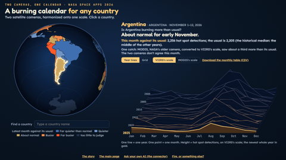

# Two Cameras, One Calendar

**A burning calendar for any country, with NASA's older and newer fire cameras put on one scale.**

Satellites have counted fire hot spots since 2000, but NASA's older fire camera, MODIS, is being replaced by a newer one, VIIRS, which sees far more of the same fires. Glue the two records together and the fire count seems to jump the year the camera changes. We built a method that translates one camera's counts onto the other's scale, month by month where the data allow, and a web app that lists 235 countries and territories and shows each one's record on that one scale, from November 2000 where the data go back that far.

Built for the NASA Space Apps Challenge 2026, challenge "Harmonization of MODIS and VIIRS Hot Spots", by **Spark Squad**, a homeschool family team. In the story we tell, the two cameras are characters: **Moe** is MODIS, the older camera, and **Vee** is VIIRS, the newer one.

## How AI was used

This project was made with AI tools, and we say where. Claude models (Anthropic), working through Claude Code, wrote the code, the analysis scripts and the scripts that build the data tables, under the team's direction and review; a second AI model family, OpenAI's, through the Codex command-line tool, independently recounted the main numbers and fact-checked our talk. The Fire Detectives lesson pictures were made with an AI image model run in ComfyUI, and each one carries a visible "AI-generated art" mark; the satellite characters and the scientist are hand-drawn by team members. The idea and every decision were the team's, and no AI-generated audio or video is part of this project. The full statement is in [AI_USE.md](AI_USE.md), and a machine-readable version, folder by folder, is in [AI_USE.json](AI_USE.json).

## Try it

The seven-slide demo is in this repository: [demo/Two_Cameras_One_Calendar_7_slides.pdf](demo/Two_Cameras_One_Calendar_7_slides.pdf).

| What | Where |
|---|---|
| The web app: a globe, click a country, see its burning calendar | https://dashboard.alexmong.com/spaceapps/explore.html |
| The fuller page: the answer, how we know, the record | https://dashboard.alexmong.com/spaceapps/ |
| The story we used in our talk | https://dashboard.alexmong.com/spaceapps/#story/1 |
| The connector: ask your own AI chat app | https://dashboard.alexmong.com/spaceapps/connector.html |
| The volunteer page: "Fire, or something else?" | https://dashboard.alexmong.com/spaceapps/volunteer/ |



## What the challenge asked, and what we built

NASA asked for a web application that harmonizes the MODIS and VIIRS records into a burning activity calendar, so that "the sensor of origin no longer matters".

What we built against it:

- **The harmonization.** One small JavaScript engine learns how the two cameras' counts relate, from a ten-year learning window, 2012 to 2021, when both cameras were flying (they still are). Where a country has enough fire it learns a number for each month of the year; thinner records get simpler fallbacks (see below). It then puts the record on one scale.
- **The web app.** A globe page: pick a country and see its burning calendar, month by month, with the latest month against its historical median. A fuller page answers "Is this place burning more than usual?" in plain words, shows the record year by year and month by month, and offers the monthly table as a CSV download. It lists 235 countries and territories; records begin in November 2000 where available and run as far as December 2025 (55 end earlier, and five have no usable month). Argentina also has early data through November 12, 2026.
- **The story.** A short story inside the page that walks through the problem, the fix and the test, with Moe and Vee.
- **The connector.** A Model Context Protocol (MCP) server in Node.js, so an AI chat app that supports MCP connectors can ask the same record questions. It has eleven tools and answers from the same engine and data. It can also read NASA's recent files labeled 24 hours, 48 hours and seven days; those counts come straight from NASA and are not put on one scale.
- **The volunteer page, "Fire, or something else?".** Not every hot spot is a fire: gas flares, factories and volcanoes are hot too. This page shows 50 places from 2020 in pictures and heat records and asks the visitor to judge, with NASA's own label as the answer key. It is built from NASA FIRMS data, but it does not read the harmonized record.

What we did not build: a map where you draw your own area, a latitude and longitude box on the page, and a from-to date range. The page works country by country and month by month.

## How the harmonization works

We count **hot spot detections**: a square of ground about 5 km across where a camera flagged heat on one day. One big fire makes many. It is not a count of fires and not land burned.

For a country with enough fire, for each month of the year, we add up everything Moe counted in that month across the learning window, 2012 to 2021, and divide by everything Vee counted in the same months. That gives twelve conversion numbers. For Argentina in August: 62,467 ÷ 169,528 = 0.37. Multiply Vee's count by the month's number to estimate what Moe would have counted. Divide Moe's count by it to go the other way.

Why twelve numbers, not one? The gap between the cameras changes with the seasons. In Argentina, Moe counts about 37 for every 100 of Vee's in August, and about 24 in November.

Not every place has enough fire for twelve numbers. Of the 235 places listed, 90 get a number for each month, 73 get one number for the whole year, 15 borrow a curve shared by the whole world, and 57 have too little fire to convert. The page says in plain words when a record is thin.

The full method, with worked examples: [METHOD.md](METHOD.md).

## How we tested it, and what we found

We hold one year out, learn the numbers from the other nine years of the learning window, translate the held-out year, and compare with what Moe really counted. Then we do that for every year.

- **One month.** October 2017 in Argentina: Vee counted 6,035; times 0.2873 gives 1,734; Moe counted 1,921. That is 9.7% low.
- **Argentina.** Across all 119 tested months, a typical month lands within 9.5% of Moe's own count, and nine months in ten within about 30%.
- **Beyond Argentina.** In all 71 countries with a lot of fire, a typical month lands within 25%. The middle country is at about 12%.
- **Why it matters.** Just stitched together, Vee reads about 3.5 times what Moe counts in a typical Argentine month. Among the years we could compare, 63 of 65 countries with a lot of fire have their biggest year after 2021 when the records are stitched; on VIIRS's scale, 9 do. Canada's 2023 stays its biggest year either way.

"Agrees" here means agrees with Moe, the older camera, the only one with real counts in both eras. It does not say which camera is closer to what happened on the ground. None of this is a forecast. No outside expert in satellite fire data has reviewed the work.

We also built a smarter version that sorts Vee's hot spots by fire power. With each test year left out of a country's monthly numbers, it takes Argentina from 9.5% to 7.0%, and 51 of the 71 countries improve by more than one percentage point (19 change by a point or less, 1 gets worse). It is not switched on yet; [METHOD.md](METHOD.md) says why.

## What is in this repository

| Folder or file | What it holds |
|---|---|
| `web/` | The web app as it is served (see [web/README.md](web/README.md)): the globe page (`explore.html`), the fuller page and story (`index.html`), the connector's page (`connector.html`), the seven-slide demo (`slides.html`), their CSS and JavaScript, the engine and the per-country data (`parts/engine_and_data/`), the prepared tables (`data/`) and the pictures (`img/`). Plain HTML, CSS and JavaScript: no framework, no build step, no outside library. |
| `web/tools/` | The scripts that recompute the numbers on screen (`check_numbers.cjs`) and rebuild the prepared tables in `web/data/`. They sit inside `web/` because they read the page's own files by relative path. |
| `connector/` | The MCP connector: the server, its tests, and a copy of the engine and data it answers from. Its own [README](connector/README.md) explains how to add it to a chat app. |
| `volunteer/` | The volunteer page "Fire, or something else?" (`site/`), its data, the scripts that picked the places and cut the pictures, and a small saving service that was built and tested but is **not deployed** (`picks_server/`). See [volunteer/README.md](volunteer/README.md). |
| `demo/` | The seven-slide demo as a PDF (`Two_Cameras_One_Calendar_7_slides.pdf`). The same slides are a web page at `web/slides.html`. |
| `experiments/` | A short summary of six experiments we ran on the method: [experiments/README.md](experiments/README.md). |
| `METHOD.md` | The math in plain words, with worked examples. |
| `DATA_SOURCES.md` | Every data source, tool and font, with its terms as far as we could confirm them. |
| `AI_USE.md` | How AI was used, plainly and completely. |
| `AI_USE.json` | The same, machine-readable, one entry per folder. |
| `LICENSE` | Apache License 2.0, for the code. |

## Run it on your own computer

You need Python 3 (to serve the files) and Node.js 20 or newer (for the checks and the connector). Nothing to install beyond those. Run these from the top folder of this repository.

**The web app.**

```
python -m http.server 8000 --directory web
```

Then open http://localhost:8000/explore.html (the globe), http://localhost:8000/ (the fuller page) or http://localhost:8000/#story/1 (the story). Press Ctrl+C to stop. On a local address the page also asks for an optional file, `local/addresses.js`, that is not in this repository; the browser shows one "not found" line for it, and the page works without it.

**The volunteer page.**

```
python -m http.server 8001 --directory volunteer/site
```

Then open http://localhost:8001/. The pictures marked "via GIBS" stream from NASA while you look, so they need an internet connection.

**The connector.**

```
node connector/test/run_tests.cjs
node connector/server/server.cjs
```

The first runs its checks (it ends with `TOTAL: 198 PASS, 0 FAIL`). The second starts the connector the way a chat app does: it waits for messages on standard input, so press Ctrl+C to stop it. To add it to a chat app, follow [connector/README.md](connector/README.md).

**The number checks.**

```
node web/tools/check_numbers.cjs
```

It recomputes the numbers on the main screens from the data and the engine, checks some consistency rules, and prints PASS or FAIL for each. From this repository it prints `175 PASS, 1 FAIL`. The one failure is a privacy scan that ran on the team's own computer and is not part of this repository; every number check passes.

## Data and credits, in brief

- **Fire data:** NASA FIRMS (Fire Information for Resource Management System): MODIS on the Terra and Aqua satellites and VIIRS on Suomi NPP and NOAA-20.
- **Pictures on the volunteer page:** NASA GIBS (Global Imagery Browse Services), and stored close views made from Copernicus Sentinel-2. Contains modified Copernicus Sentinel data 2020.
- **Country outlines:** Natural Earth (public domain).
- **Fonts:** Fredoka, Lexend and JetBrains Mono, loaded from Google Fonts.
- **Art:** the two satellite characters and the scientist were drawn by hand by team members. The Fire Detectives lesson pictures shown in the story were made with an AI image model run in ComfyUI; each picture carries a visible "AI-generated art" mark.

The full list, with terms: [DATA_SOURCES.md](DATA_SOURCES.md).

## License

The code is under the [Apache License 2.0](LICENSE). The license does not cover the art (the hand-drawn characters and the AI-made lesson pictures) or the data; their terms are listed in [DATA_SOURCES.md](DATA_SOURCES.md) and [AI_USE.md](AI_USE.md).
